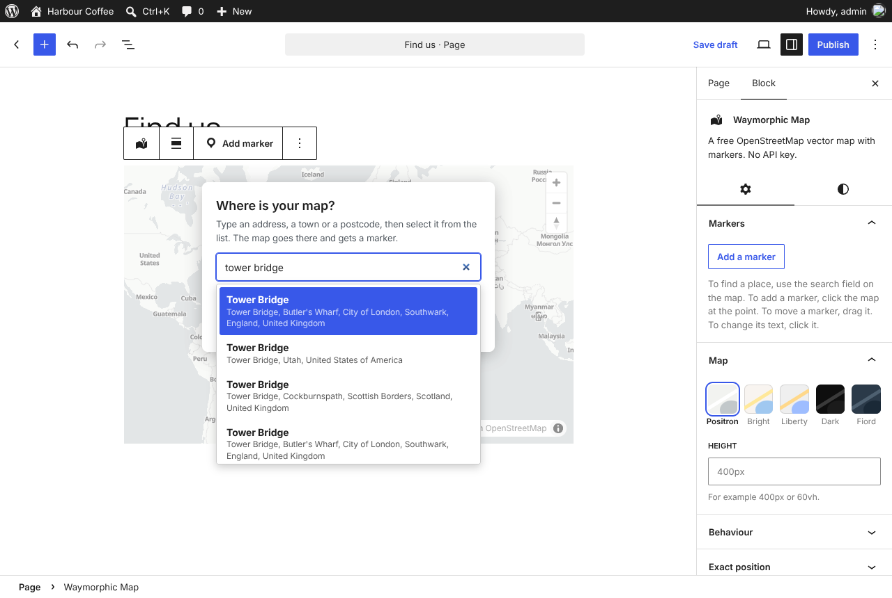
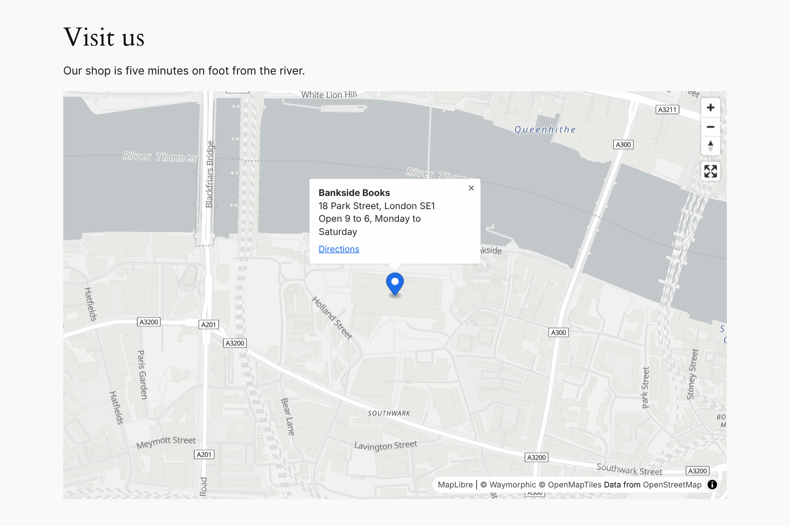
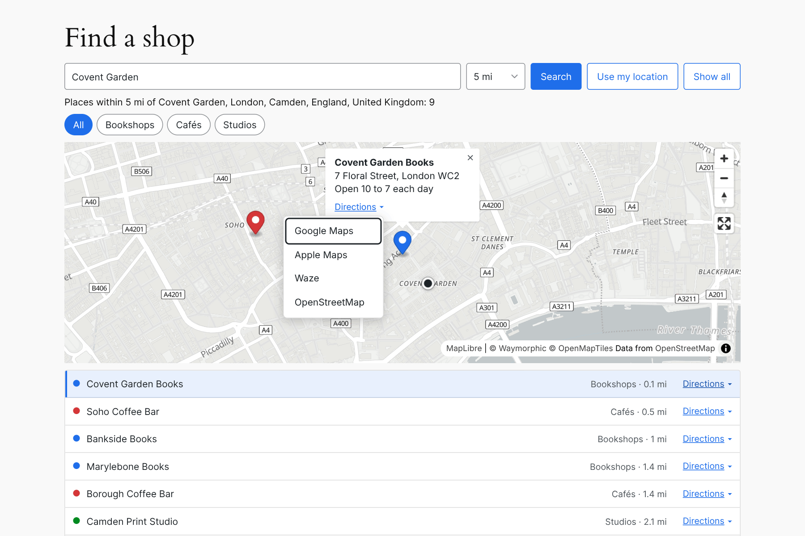
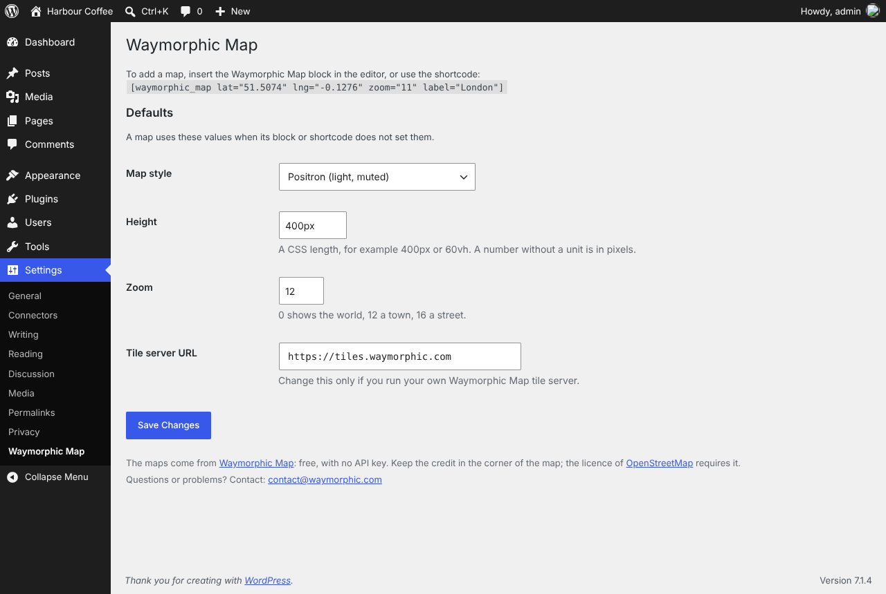
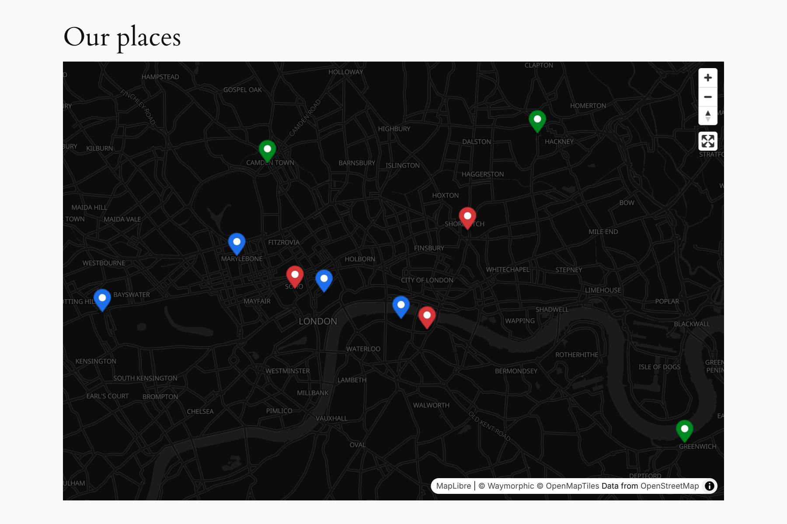
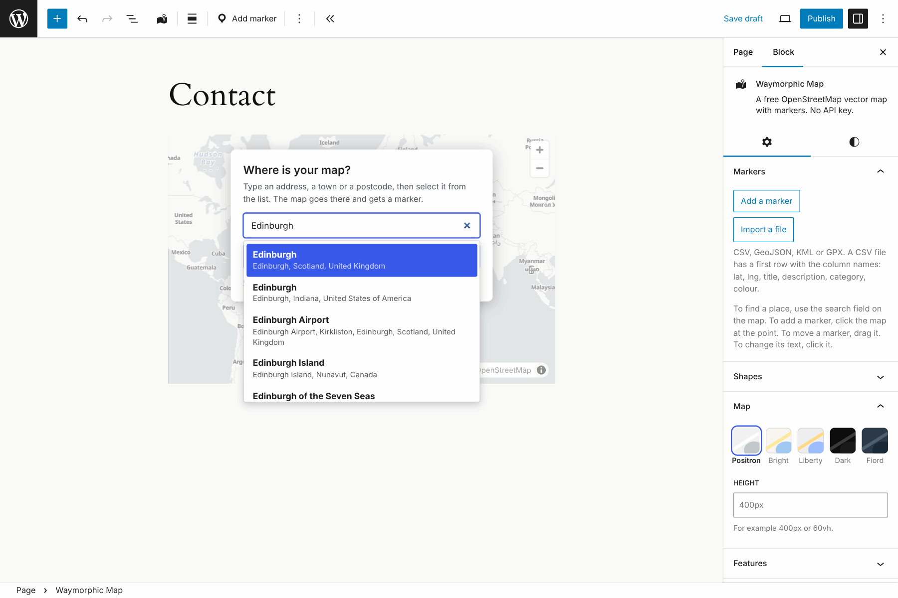
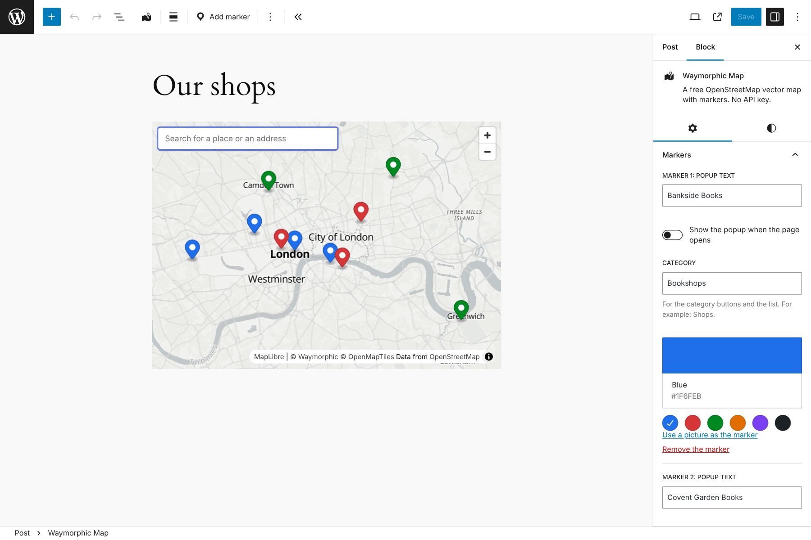

# Waymorphic Map & Custom Maps - No signup required

Free OpenStreetMap vector maps for WordPress sites, from [Waymorphic Map](https://waymorphic.com/). A block and a shortcode, five styles, markers with popups, shapes, a marker list and a search for the nearest markers. No API key, no account.

- **Plugin directory of WordPress:** <https://wordpress.org/plugins/waymorphic-map/>. This page goes live when the review of the plugin is complete.
- **Zip file of the latest release:** [waymorphic-map.zip](https://github.com/jamescball/waymorphic-map-wordpress/releases/latest/download/waymorphic-map.zip)
- **Pictures and instructions on the Waymorphic site:** <https://waymorphic.com/wordpress>



## Screenshots

| | |
| :---: | :---: |
| <br>A map with a marker, a popup and a directions link | <br>The visitor selects the map service of the directions |
| <br>Shapes on the Bright style: an area, a route, a circle | <br>A colour for each category, on the Dark style |
| <br>A new block asks for the place | <br>The block in the editor |

The settings page is in [screenshot-8.png](.wordpress-org/screenshot-8.png).

## Install

WordPress 6.3 or later, PHP 7.4 or later. The plugin has no account, no API key and no setup.

**From the plugin directory of WordPress** (when the page of the plugin is live):

1. In the administration of your site, go to Plugins > Add New Plugin.
2. Search for "Waymorphic Map".
3. Select "Install Now", then "Activate".

**From the zip file of a release:**

1. Download [waymorphic-map.zip](https://github.com/jamescball/waymorphic-map-wordpress/releases/latest/download/waymorphic-map.zip).
2. Go to Plugins > Add New Plugin > Upload Plugin.
3. Select the zip file, then "Install Now".
4. Select "Activate Plugin".

**From the source:** copy this folder to `wp-content/plugins/waymorphic-map` and activate **Waymorphic Map & Custom Maps - No signup required** on the Plugins screen. There is no build step.

**Upgrade from version 1.1.0 or 1.2.0:** those versions had other folder names (`wp-free-maps` and `free-maps-waymorphic-map`), so WordPress installs this version as a second plugin. Install and activate this version. Then deactivate the older version on the Plugins screen and delete it. A message in the administration tells you which version to deactivate: the plugin does not deactivate it. Then empty your page cache. The settings and the maps stay.

## Quick start

**A map with the block:**

1. Open a post or a page in the editor and add the "Waymorphic Map" block.
2. The block asks "Where is your map?". Type an address, a town or a postcode, then select the place from the list. The map goes there and gets a marker.
3. Click the marker and write its popup text. To add a marker, click the map at the point, then select "Add a marker here". To move a marker, drag it.
4. In the sidebar of the block, the "Map" panel has the five map styles and the height. The "Features" panel has the list of the markers, the search for the nearest markers, the category buttons and the directions link.
5. Save the page.

**A map with the shortcode:**

1. Add a "Shortcode" block to a post or a page. The shortcode also operates in the classic editor, in a widget and in a template.
2. Write the shortcode, for example `[waymorphic_map address="10 Downing Street, London" zoom="16"]`.
3. Save the page.

**A store locator:**

1. Add a map with a marker for each of your places. The first line of the popup text of a marker is its name in the list. Give each marker a category if you have different types of places.
2. In the "Features" panel of the block, set "List of the markers below the map", "Search for the nearest markers", "Category buttons" and "Directions link" to on. On the shortcode, these are `list="true"`, `locator="true"`, `filter="true"` and `directions="true"`.
3. Save the page. Visitors type an address, or use their location, and see the nearest places with the distances.

## Use

**Block.** Add the "Waymorphic Map" block. A new block asks "Where is your map?": type an address, a town or a postcode and select it from the list. The map goes there and gets a marker. "Use my location" does the same with the position that the browser gives. After that, the search field is on the map. Drag the map to set the view. Click the map, then select "Add a marker here", to add a marker at that point. Drag a marker to move it, and click it to change its text or remove it. In the sidebar, select the style from the five swatches and set the height.

**Shortcode.**

```
[waymorphic_map lat="51.5074" lng="-0.1276" zoom="11" label="London"]

[waymorphic_map address="10 Downing Street, London" zoom="16" style="bright"]

[waymorphic_map height="500"]
[waymorphic_marker lat="48.8584" lng="2.2945"]<strong>Eiffel Tower</strong>[/waymorphic_marker]
[waymorphic_marker lat="48.8606" lng="2.3376" open="true"]The Louvre[/waymorphic_marker]
[/waymorphic_map]
```

| Attribute | Meaning | Default |
| --- | --- | --- |
| `lat`, `lng` | Centre of the map. `lon` and `long` are other names for `lng` | Fits the markers, or shows the world |
| `address` | Address or place name, used when `lat` and `lng` are not given | |
| `zoom` | 0 to 22. When the view fits two or more markers: the upper limit of the view | Setting (12); 15 for a view that fits markers |
| `style` | `positron`, `bright`, `liberty`, `dark`, `fiord` | Setting (`positron`) |
| `height` | CSS length (`400px`, `60vh`); a number is in pixels; not a percentage. Units: `px`, `vh`, `vw`, `dvh`, `svh`, `lvh`, `dvw`, `svw`, `lvw`, `vmin`, `vmax`, `em`, `rem`, `ch` | Setting (`400px`) |
| `width` | CSS length (`300px`, `50%`); a number is in pixels | `100%` |
| `marker` | `true` puts a marker at the centre | On with `label` or `address` |
| `label` | Popup text of the marker at the centre | |
| `controls` | `false` hides the zoom and fullscreen buttons | `true` |
| `scroll_zoom` | `true`: plain scroll zooms the map. `false`: ctrl or cmd + scroll, and two fingers move the map on a touch screen | `false` |
| `interactive` | `false` makes a still map | `true` |
| `title` | Name of the map for screen readers | `Map` |
| `popup_title` | `false`: the popup of a marker does not start with the `title` of the marker | `true` |
| `cluster` | `true` puts markers that are near to each other in a group | `false` |
| `list` | `true` shows the list of the markers below the map | `false` |
| `locator` | `true` shows the search for the nearest markers | `false` |
| `radius`, `unit` | First distance of the search; `km` or `mi` | `25`, `km` |
| `filter` | `true` shows a button for each marker category | `false` |
| `directions` | `true` adds a directions link to the popups and the list. The link opens the map service of the settings. Or give the service: `google`, `apple`, `waze`, `osm`. Or `choice`: the visitor selects the service from a list | `false` |
| `locate` | `true` shows the button for the position of the visitor | `false` |
| `animation` | `drop` or `bounce`, for all the markers | |
| `colour` | Colour of the marker at the centre, such as `#d63638` | |

`[waymorphic_marker]` takes `lat` and `lng` (or `address`) and `open="true"`. Its content is the popup. Optional: `title` (the name in the list and the first line of the popup), `category`, `colour`, `icon` (URL of a picture) and `animation`. A marker with no popup text can have a slash at the end and no closing tag: `[waymorphic_marker lat="51.5" lng="-0.12" /]`.

Use straight quotes in the shortcodes. When an address is not found, a position is not valid, or the search found an address very far from the places of the map that have a `lat` and a `lng` (the map must have two such places, or a centre with a `lat` and a `lng`), the users who can edit the page see a message below the map. Visitors do not see it. The search gives the place that it knows best: write the town in an address, and the area or the full name of the country when other towns have the same name (`address="Buckingham Palace, London"`, `address="Boston, Lincolnshire"`). Write `United Kingdom` and `United States`, not `UK` and `USA`. In a very large country, a correct town can be that far: with the full name of its area or of its country in the address (`address="Perth, Western Australia"`), it gets no message.

**Shapes**, in `[waymorphic_map]`. The points are `latitude,longitude` pairs with `;` between them. The content is the popup.

```
[waymorphic_map locator="true" list="true" filter="true" directions="true"]
[waymorphic_marker lat="51.5074" lng="-0.1276" title="London shop" category="Shops" colour="#d63638"]Open 9 to 5[/waymorphic_marker]
[waymorphic_polygon points="51.50,-0.20; 51.55,-0.12; 51.50,-0.05" colour="#008a20"]Delivery area[/waymorphic_polygon]
[waymorphic_line points="51.50,-0.20; 51.52,-0.10" width="4"]
[waymorphic_circle lat="51.5074" lng="-0.1276" radius="500"]
[waymorphic_rectangle points="51.48,-0.20; 51.49,-0.15"]
[/waymorphic_map]
```

All shapes take `colour` and `width`. Polygons, circles and rectangles take `fill` and `opacity` (0 to 1). The radius of a circle is in metres. A rectangle takes two opposite corners. A polygon or a line has 500 points at most.

**Heatmap and files**, in `[waymorphic_map]`:

```
[waymorphic_heatmap points="51.50,-0.12; 51.51,-0.11,3; 51.52,-0.10" radius="30"]
[waymorphic_file url="https://example.com/wp-content/uploads/shops.csv" category="Shops" colour="#008a20"]
[waymorphic_file url="https://example.com/wp-content/uploads/walk.gpx"]
```

A heatmap point can have a weight as a third number. `[waymorphic_file]` shows the markers, lines and areas of a CSV, GeoJSON, KML or GPX file. The browser gets the file on each page view, so the file must be on the site or on a server that permits the site to read it (CORS). A CSV file has a first row with the column names: `lat`, `lng`, and the optional `title`, `description`, `category`, `colour`, `icon`. A position is a number (`51.5074`, `51,5074`, `0.1276 W`): a row whose position has other text does not show. Text from a file shows as plain text. For a file with some hundreds of markers or more, use `cluster="true"`: the map draws only the markers that are not in a group.

**In the block:**

- The "Features" panel has the list, the search, the groups of markers, the category buttons, the directions link with its map service, the location button and the animation.
- Each marker has a category, a colour and an optional picture.
- The "Shapes" panel draws polygons, lines, circles and rectangles: select a type, then click the map.
- "Import a file" in the Markers panel adds the markers and shapes of a CSV, GeoJSON, KML or GPX file to the block. The file is not uploaded. A block can have 1000 markers; one file gives 100 shapes at most, and a line keeps 500 points.
- The block has no heatmap: use the shortcode.

**Settings.** Settings > Waymorphic Map: default style, height and zoom, the map service of the directions link, and the tile server URL for a self-hosted server.

**Directions.** The directions link opens Google Maps, Apple Maps, Waze or OpenStreetMap with the position of the marker. Select the service in the settings, or for one map (`directions="google"` on the shortcode, "The directions link opens" in the "Features" panel of the block). With `choice`, the link is a button: it shows the list of the services and the visitor selects one.

**Colours.** The parts around the map (the search, the category buttons, the list) keep their look in each theme: the usual CSS rules of a theme or of the site do not change them. To change them, set CSS variables on a parent of the map, for example in Appearance > Customize > Additional CSS (for a change that the variables do not make, write `!important` in your CSS rule):

```css
.wp-block-waymorphic-map {
	--waymorphic-map-accent: #b32d2e;      /* buttons, links, the selected row */
	--waymorphic-map-accent-text: #fff;    /* text on the accent colour */
	--waymorphic-map-text: #1d2327;
	--waymorphic-map-muted: #50575e;       /* category and distance in the list */
	--waymorphic-map-surface: #fff;        /* background of the fields and the list */
	--waymorphic-map-border: #8c8f94;      /* border of the fields and the buttons */
	--waymorphic-map-line: #dcdcde;        /* lines in the list */
	--waymorphic-map-radius: 4px;
	--waymorphic-map-font-size: 14px;
	--waymorphic-map-list-height: 320px;   /* largest height of the list */
	--waymorphic-map-scheme: light;        /* light or dark: the parts that the browser draws (the scroll bar of the list), for a dark surface */
	--waymorphic-map-popup-accent: #b32d2e; /* links in a popup (the accent colour, if not set). A popup is white on each site: set this when the accent colour is light */
	--waymorphic-map-scroll-space: 4rem;   /* space above the map after a click in the list, for a header that stays at the top */
}
```

## For developers

- `waymorphic_map_render( $args )` returns the HTML of a map. Use it in a template. A classic theme that makes a map in a template (with this function or with `do_shortcode()`) must call `wp_enqueue_style( 'waymorphic-map' )` in a function on `wp_enqueue_scripts`: without this, the styles of the map load after the map.
- Filter `waymorphic_map_config`: the configuration of one map before output.
- Filter `waymorphic_map_tiles_url`: the tile server URL.
- Filter `waymorphic_map_directions_services`: the map services of the directions link. Each service is `'name' => array( 'label' => ..., 'url' => ... )`. In the URL, `{lat}` and `{lng}` are the position of the marker.
- Filter `waymorphic_map_directions_url`: the address of the directions link when the link opens one service. The second argument is the name of the service. The address must start with `http` or `https`.
- Filter `waymorphic_map_trusted_addresses`: more addresses that a map element of a page can use as its style or its search (full addresses, or the start of addresses with a slash at the end). The script starts a map element of the page only when its style is on the tile server of the site, or is a style that PHP gave for this page (also through `waymorphic_map_config`): a writer with no right to use scripts must not select the style of a map. `WaymorphicMap.create()` has no such limit.
- The configuration of a map is in the `data-waymorphic-map` attribute of its element. A configuration of more than 100,000 characters is in a `script.waymorphic-map__config` element in the map element.
- JavaScript: each `.waymorphic-map` element has its MapLibre map in `element.waymorphicMap`. A map starts when it comes near the viewport: the element sends the `waymorphic-map:ready` event (it bubbles; the map is in `event.detail.map`) when its markers and shapes are there. `WaymorphicMap.init( root )` starts maps that you add to the page later. `WaymorphicMap.addShapes( map, WaymorphicMap.shapeFeatures( shapes ) )` adds shapes to a map whose style is ready (the points of the shapes are `[ lng, lat ]`). `WaymorphicMap.parseData( text, name )` reads the markers and shapes of a CSV, GeoJSON, KML or GPX file.

```
waymorphic-map.php            plugin header and hooks
includes/copies.php           the notice when two copies of the plugin are active
includes/options.php          options and input cleaning
includes/render.php           assets, map markup, address lookup
includes/shortcode.php        [waymorphic_map], [waymorphic_marker] and the shape shortcodes
includes/block.php            block registration and render callback
includes/settings.php         settings page
block/                        block.json and the editor script
assets/js, assets/css         front-end script and style
assets/vendor                 MapLibre GL JS 5.21.0 (BSD 3-Clause)
```

## Release

1. Set the same version in the plugin header and the `WAYMORPHIC_MAP_VERSION` constant in `waymorphic-map.php`, and in `Stable tag` in `readme.txt`. Add a changelog entry in `readme.txt`.
2. `bin/build-zip.sh` makes `build/waymorphic-map.zip` from the last commit. The script stops if the three version numbers are different.
3. Push a tag such as `v1.0.0`. The Release workflow builds the zip and attaches it to a GitHub release. The release notes are the changelog entry of that version in `readme.txt`. The workflow stops if the tag and the plugin version are different, or if the changelog has no entry for the version.

The CI workflow runs on each push and pull request: a PHP syntax check on PHP 7.4 and 8.3, and a build of the zip, which it keeps as an artifact.

`.wordpress-org/` holds the icon, banner and screenshots for the WordPress.org plugin directory. These files go in the `assets` folder of the plugin's SVN repository, not in the zip.

## Service and credit

Maps come from `https://tiles.waymorphic.com`. The service is free and best effort. Keep the credit on the map: map data © [OpenStreetMap](https://www.openstreetmap.org/copyright) contributors, schema by [OpenMapTiles](https://openmaptiles.org/). See [fair use](https://waymorphic.com/#fair).

## Contact

Questions and problem reports: [contact@waymorphic.com](mailto:contact@waymorphic.com).

## Licence

GPL-2.0-or-later. MapLibre GL JS has its own licence in `assets/vendor/maplibre-gl/LICENSE.txt`.
